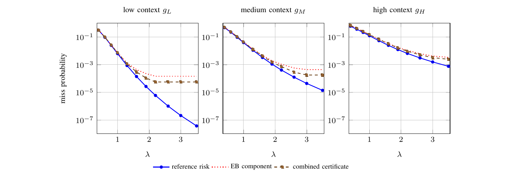

# Reproducibility package: Closed-Loop Calibrated Robustness for Tube MPC

This repository contains the code, numerical records, and figure-generation
files for the experiments reported in
**“Closed-Loop Calibrated Robustness for Tube MPC: Risk-Budgeting under Feedback Covariate Shift.”**

The final eight-page manuscript is included as [`paper/manuscript.pdf`](paper/manuscript.pdf).
The manuscript LaTeX source is intentionally **not** included. The repository is
intended to reproduce and audit the computational results, tables, and figures.

Repository: https://github.com/beppe969/calibrated_MPC

## Reproduce

Use Python **3.13.5** and the pinned numerical environment:

```bash
python -m venv .venv
source .venv/bin/activate
python -m pip install -r requirements.lock
```

On Windows, activate the environment with `.venv\Scripts\Activate.ps1` in
PowerShell. The tested environment is recorded in
`validation/environment.json`.

Check the supplied records and run a short simulation:

```bash
python reproduce.py verify
python reproduce.py smoke
```

Recompute **every numerical experiment from its random seeds**, compare with the
supplied records, and regenerate all figures and exported tables:

```bash
python reproduce.py all
```

The full command writes to `build/all/`. It includes the six-budget study with
500 missions per method, the matched-query calibration-size sweep, the
geometry/selection ablation, the prescribed-shift study, and the
empirical-Bernstein versus combined-certificate comparison.

Use

```bash
python reproduce.py run
```

for the complete numerical reproduction without rendering figures.

The numerical code requires NumPy, SciPy, and pandas. The four paper figures are
rendered from their TikZ/PGFPlots plotting sources. Install a TeX distribution
containing IEEEtran and PGFPlots, together with the `preview` package. PNG
previews also require Poppler's `pdftoppm`. On Ubuntu/Debian:

```bash
sudo apt-get install texlive-latex-extra texlive-pictures \
  texlive-fonts-recommended texlive-publishers poppler-utils
```

After installation, the experiment and rendering commands work offline.

## Rebuild figures from the supplied data

```bash
python reproduce.py figures
```

This writes all four figures as vector PDFs and PNG previews under
`build/figures/`. It requires no new simulations. Prebuilt versions are in
[`artifacts/figures/`](artifacts/figures/).



The exact numerical files used by the plotting layer are regenerated from one
results directory. Every input in `paper/data/` is checked by the verification
command. The matching Table II export is available in
[`artifacts/export/tables/table_2_benchmark.md`](artifacts/export/tables/table_2_benchmark.md).

## Repository contents

| Location | Contents |
|---|---|
| `src/` | Tube-MPC experiment and certificate comparison |
| `reference/results/` | Complete numerical records, including every executed stage |
| `reference/inputs/` | Independent main design and calibration samples |
| `paper/manuscript.pdf` | Final eight-page manuscript; manuscript source is not included |
| `paper/data/`, `paper/figures/` | Numerical plotting inputs and figure-generation sources |
| `artifacts/` | Prebuilt figures and exported tables |
| `tests/`, `scripts/` | Unit tests, independent checks, export and rendering tools |
| `validation/` | Full-run comparison, environment record and integrity manifest |
| `docs/` | Experiment specification, figure/table map, and data dictionary |

The supplied experiment records include **370,000 main-study stages** and
**80,000 additional stages** from the ablation and shift studies together with
the certificate comparison. Each stage remains individually inspectable.

## Verification

The numerical reproduction checks integer outcomes and selected radii against
the reference records. Floating-point comparisons use absolute tolerance
`1e-8` and relative tolerance `1e-9`; exogenous arrays must match exactly.
Measured wall-clock timing columns are excluded. The supplied validation reports
the discrepancies from the full rerun.

Independent checks reconstruct each transition and common stage cost. They also
check the complete risk ledger and regenerate the calibration tables. The unit
tests cover the condensed QP, tube support, and exact-binomial bounds. These
checks concern implementation consistency; the statistical guarantees retain
the assumptions stated in the manuscript.

```bash
python reproduce.py integrity  # SHA-256 checks for the packaged release
python reproduce.py export     # regenerate numerical inputs and tables
python reproduce.py figures    # rebuild the four paper figures
```

Generated output stays separate from `reference/`. A full rerun refuses to
replace an existing results directory. For another run, choose a fresh location:

```bash
python reproduce.py all --output build/second_run
```

The package sets numerical thread counts to one before loading NumPy/SciPy. The
full-run duration and machine details appear in `validation/`. Hardware and
software builds can affect numerical and timing reproducibility; the comparator
reports discrepancies and exits with a failure status when tolerances are
exceeded.

## Documentation

See [the experiment specification](docs/EXPERIMENTS.md) for all methods and
seeds. The [data dictionary](docs/DATA_DICTIONARY.md) explains the recorded
quantities. The [figure and table map](docs/FIGURE_TABLE_MAP.md) identifies the
input records for each result. The
[reproducibility guide](docs/REPRODUCIBILITY.md) describes verification scope
and implementation details.

## GitHub

The included workflow runs integrity checking, numerical verification, a smoke
test, and a figure build on pushes and pull requests. A manually triggered full
500-mission reproduction is available through the workflow's
`full_reproduction` option.
